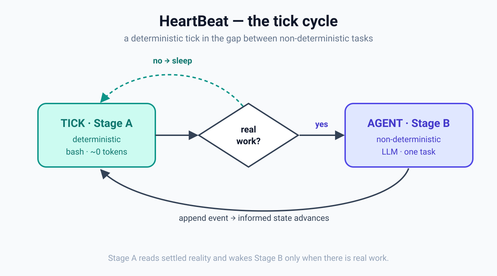
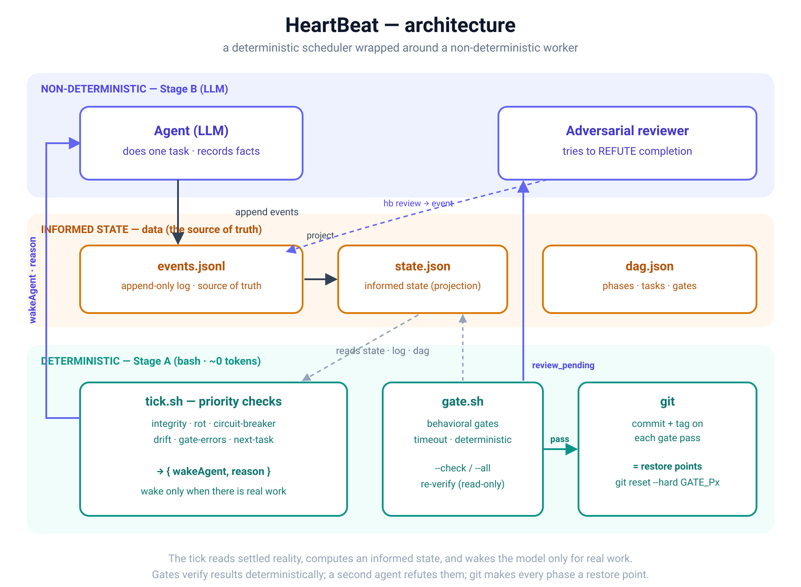

# The gaps are deterministic

A note on how I run long, non-deterministic agents without losing the thread.
Sharing it in case it's useful.

LLM agents are non-deterministic: same prompt, different path, sometimes a different
outcome. That's fine for one answer; it's hard for a project that runs for hours
across many steps. The agent drifts, forgets, repeats itself, and you can't tell
where it is or whether what it did holds up.

The starting observation was simple. The non-determinism lives *inside* the tasks —
the reasoning, the writing, the choices. But the time *between* tasks is
deterministic. In the gap after one unit of work settles and before the next begins,
nothing is being generated: the files are what they are, the state is settled,
reality is observable with no model in the loop.

That gap is a deterministic component sitting inside a non-deterministic flow. If you
have a reliably deterministic moment, you can use it to compute an *informed state* —
look at exactly what exists, decide what should happen next, and only then spend the
expensive, unpredictable resource (the model), and only if there's actually something
to do.

A *tick* is a deterministic observation dropped into that gap. The rest follows from
it.

## Two stages

- **Stage A — the tick.** Cheap, deterministic code (bash). It runs on a schedule,
  reads the settled reality (event log, state, gates), and outputs one thing: should
  the agent wake, and why. It never generates anything and costs almost nothing.
- **Stage B — the agent.** The non-deterministic worker. It runs only when Stage A
  says there's real work, does one unit of it, records the outcome, and stops.

Splitting them keeps scheduling free and observable, and reserves the model for the
one thing only it can do.

## Informed state

State isn't hand-edited by the agent — it's a projection of an append-only event log.
The agent appends facts ("started this", "finished that", "gate passed"); the
deterministic layer derives the current picture from them, the same way every time.
So the state is reconstructible: a session dies, the next tick rebuilds it from the
log and continues. Nothing is remembered; it's computed.

## Shape and gates

The project is described as a DAG: phases, tasks, dependencies, and gates. A gate is
a behavioral checklist that must pass before a phase counts as done — not "does the
file exist" but "does the thing work." Deterministic, fast, reproducible. A phase
doesn't advance until its gate passes. You don't trust the process; you verify the
result at defined checkpoints.

## Refute, don't confirm

The weak spot in "verify the result" is that the agent often writes both the code and
the test that grades it. A confirmer looks for reasons to say yes, and a model is good
at producing those. So sensitive gates aren't confirmed, they're refuted: after the
deterministic gate passes, a second agent is asked to *prove the phase isn't done* —
find the hollow test, the meaningless-but-green criterion, the faked output. The phase
advances only if that agent fails to break it. Looking for the one reason to say no
catches what looking for reasons to say yes waves through.

Two smaller things fall out of the same idea. Gates prove something at the moment they
pass, but files change later and a passed gate can start silently lying — so the
deterministic layer re-checks its own past claims and won't let a change that breaks
one slip by. And because the tick knows the true state, it can notice when the
non-deterministic side gets stuck (an agent looping, a review never answered) and
escalate instead of waiting forever.

## Using it

Roughly:

1. **Init** a project — this scaffolds a `.hb/` folder and a git repo.
2. **Describe the work as a DAG** (`dag.json`) — phases, tasks, and gates. There's a
   helper that turns a written plan into one and lints it.
3. **Drive the tick on a timer** — a loop, system cron, or a scheduled job. Each tick
   either sleeps or wakes the agent with a reason: do the next task, run a gate, run
   the adversarial review, or stop because something needs a human.
4. **Each gate pass commits and tags**, so every phase is a restore point.

That's the shape of it. You describe the work and the checks; the tick decides,
cheaply and deterministically, when to spend the model.
