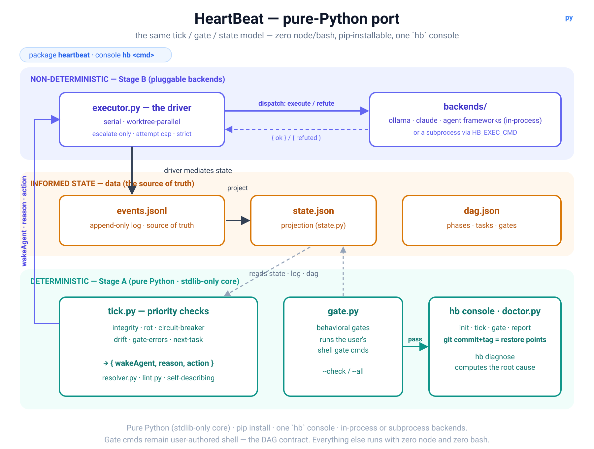

# HeartBeat (pure-Python port)

A `pip install`-able HeartBeat with **zero node/bash** in the substrate. The tick,
resolver, gates, state projector, and executor are all Python (stdlib-only core); the
model backends — local (`ollama`), headless CLI agents (`claude-code`, `codex`, `opencode`),
and seven agent frameworks — are optional and fit natively.

This is a parallel implementation of the same DAG/gate/event model as the node+bash
plugin — the `dag.json` format and the tick protocol are identical.



> **Scope note.** Gate `cmd`s are user-authored shell one-liners (the DAG contract) and
> still run via the system shell. "Zero node/bash" means *HeartBeat's own tooling* is
> pure Python — you can write gates in Python, and drive real models with no node.

## Install

```bash
pip install ./py                 # core only (stdlib)
pip install "./py[agno]"         # + Agno backend
pip install "./py[crewai]"       # + CrewAI backend
```

Requires Python ≥ 3.9. `git` is optional (restore points). Ollama backend needs an
Ollama server; it uses only the stdlib (no extra install).

## Use

```bash
hb init <project-dir>              # scaffold .hb/ (dag.json, state, events, executor.json)
hb lint  --dir <project-dir>       # validate the DAG (structure)
hb audit --dir <project-dir>       # adversarial gate-quality review (hollow gates)
hb audit --agent --dir <dir>       # + a backend refutes the plan's semantics
hb tick  --dir <project-dir>       # one Stage-A tick -> {wakeAgent, data}
hb gate  <GATE> --dir <dir>        # run a behavioral gate (--check = read-only)
hb report --dir <project-dir>      # progress
hb doctor --dir <project-dir>      # integrity / rot check
hb diagnose --dir <project-dir>    # computed root-cause for a blocked state
hb exec run --dir <project-dir>            # drive the loop with a backend
hb exec run --parallel 4 --dir <dir>       # worktree-isolated fan-out
hb mcp-serve --dir <project-dir>           # serve as an MCP server (stdio; --http for HTTP)
hb bench --dir <p> --backend a --backend b # score the same DAG under N backends (behavioral)
hb bench --dir <p> --backend a --backend b --baseline a   # + model-regression verdict vs baseline
hb reward --dir <project-dir>              # verifiable-reward stream: {gate,phase,passed,actor,ts} per gate eval
```

State is mutated only through the CLI (`hb start|done|fail|review|rebuild`), never by
hand — `state.json` is a projection of `events.jsonl`.

## Backends

Pick with `.hb/executor.json` `{"backend": …}` or `HB_EXEC_BACKEND`:
`ollama` (local, no key); the headless CLI agents `claude-code`, `codex`, `opencode`; the
seven agent frameworks `agno`/`crewai`/`langgraph`/`openai-agents`/`autogen`/`smolagents`/`pydantic-ai`
(set `HB_EXEC_PROVIDER=ollama` for local models or `anthropic`/`openai` with a key); or a
`script`/command via `HB_EXEC_CMD`. In-process backends implement `execute(payload)->{ok,summary}`
and `refute(payload)->{refuted,findings}`.

## Live proof

```bash
python3 real-backend.py ollama qwen2.5:7b-instruct
```
Drives a project where a local model writes `greeting.py` and a **Python** gate imports
and runs it — a fully node/bash-free end-to-end run.

## Tests

```bash
pip install "./py[test]"                          # test deps (pytest)
cd py && PYTHONPATH=src python3 -m pytest -q      # the full Python suite
```
